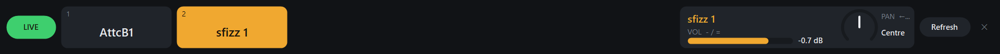

# Sonar Live Panel

Play Cakewalk Sonar live like a hardware synth: press **1–8** on your computer keyboard to jump
to a track (its synth then plays from your MIDI keyboard), step with the arrow keys, and nudge
volume and pan. A slim bar docked along the bottom of the screen shows the track names with the
current one highlighted.

Pin an always-on track (a guitar or vocal mic) so switching synths never touches it:

It works by pretending to be a **Mackie Control** surface. Sonar already supports those, so it
sends the panel its track names and responds to its buttons. No Sonar plug-in is needed.

## Download

Get `SonarLivePanel-Setup.exe` from the [Releases](../../releases) page and run it. It installs just
for your Windows user, so no admin rights are needed. Windows may show a SmartScreen warning
because the installer isn't code-signed: click **More info → Run anyway**.

**You'll need:**
- Windows 10 or 11
- Cakewalk Sonar (also likely to work with Cakewalk by BandLab, though that's untested)
- [loopMIDI](https://www.tobias-erichsen.de/software/loopmidi.html), free, to connect the
  panel to Sonar
- a MIDI keyboard

> Sonar Live Panel is an independent project. It is not affiliated with, endorsed by or supported
> by BandLab Technologies. Cakewalk and Sonar are trademarks of BandLab Technologies. Mackie Control
> is a trademark of LOUD Audio, LLC.

## One-time setup

1. **Install loopMIDI** (free, by Tobias Erichsen) and create two ports, named exactly
   `To Sonar` and `From Sonar`. Leave loopMIDI running. (Tick its "start minimized with
   Windows" option so you don't forget it at a gig.)
2. **Sonar → Edit → Preferences → MIDI → Devices**: each loopMIDI port shows up in both
   lists, but tick each one only once, alongside your MIDI keyboard:
   - *Inputs*: tick `To Sonar` only
   - *Outputs*: tick `From Sonar` only

   Ticking the other two would let Sonar's messages loop straight back into itself.
3. **Preferences → MIDI → Control Surfaces**: click **+**, choose **Mackie Control**, and set
   - Input port: `To Sonar`
   - Output port: `From Sonar`

   Then click Apply.
4. **Make your keyboard follow the current track**: in Preferences → MIDI → Playback and
   Recording, turn on **Always Echo Current MIDI Track**. Then, in **Utilities → Mackie
   Control - 1**, tick **Select highlights track** (and leave "Double-click to select"
   off). Without it, picking a track in the panel doesn't change which synth you hear.
5. On each instrument track, set the **input to your MIDI keyboard** rather than
   "Omni", so nothing from the loopMIDI ports can reach your synths as notes.
6. **Install the panel**: run `SonarLivePanel-Setup.exe`. It installs just for your Windows
   user, so no admin rights are needed, and offers Start Menu, desktop and
   start-with-Windows shortcuts. Its last page tells you whether loopMIDI and both ports were
   found.

## Install, update, uninstall

- **Update**: run a newer `SonarLivePanel-Setup.exe`. It closes the panel if it's running and
  replaces the program. Your `settings.ini`, saved track names and pin are kept.
- **Uninstall**: Windows **Settings → Apps → Installed apps → Sonar Live Panel →
  Uninstall**. You can choose to also delete your settings, names and pin.
- **Where it lives**: `%LOCALAPPDATA%\Programs\Sonar Live Panel`. Your `settings.ini`,
  `names.txt` and `pinned.txt` are there too.
- **Silent install** (e.g. for a second laptop): `SonarLivePanel-Setup.exe /silent`,
  optionally adding `/desktop` and `/startup`. Silent uninstall:
  `Uninstall.exe /uninstall /silent` (add `/purge` to delete settings too).

## Use

Start loopMIDI and Sonar (with your MIDI keyboard already plugged in), then start
**Sonar Live Panel** from the Start Menu. It docks along the bottom of the screen, and a maximized Sonar resizes
to sit above it. Close it with the **✕** at its right end.

The bar shows one button per track, the current track's volume and pan, and a **Refresh**
button. Sonar ignores the panel while a dialog such as Preferences is open. If no tracks
appear, close any Sonar dialogs. The panel retries by itself, or you can click Refresh.

| Key | Does |
|---|---|
| `1`–`8` (or numpad) | Jump to that track button (the pinned track is skipped) |
| `↑` / `↓` | Previous / next track (scrolls past the 8 shown) |
| `PgUp` / `PgDn` | Show the previous / next 8 tracks |
| `-` / `=` (or numpad `-` `+`) | Volume down / up on the current track |
| `←` / `→` (or `[` `]`) | Pan left / right |
| `Shift` + `-` / `=` | Volume down / up on the pinned track |
| `Scroll Lock` | Live mode on/off. Turn it **off** to type normally, e.g. when renaming tracks. |

Mouse: click a track to pick it. The mouse wheel over the current-track box changes volume,
over the pan knob changes pan, and over the pinned box changes the pinned track's volume.
The panel never takes keyboard focus from Sonar, so Sonar's own shortcuts like Space still work.

### Pinning an always-on track (e.g. a guitar or vocal)

**Right-click** a track to pin it. A pinned track gets its own box at the left with its
own volume, and switching (`1`–`8`, `↑`/`↓`) skips it, so `1` is always your first synth.
Right-click the pinned box to unpin it. The pin is remembered between runs (`pinned.txt`).

The panel only controls switching. To keep the audio track **audible** while you change synths,
turn that track's **input echo** on in Sonar (or, for a backing track, just let it play).
"Always Echo Current MIDI Track" only affects MIDI tracks, so switching synths won't silence
it. The panel can only reach tracks among the 8 Sonar is currently showing it, so with more
than 8 tracks, keep the pinned one next to your synths.

To change keys, ports or step sizes, edit `settings.ini` and restart the panel.

## Tips and troubleshooting

- **Names are shortened** (e.g. `AttcB1`). Sonar only sends 6 characters per track. The panel
  learns each full name the first time you pick that track and remembers it (`names.txt`), so
  step through all your tracks once after adding or renaming them.
- **Volume says "Sonar hasn't reported this fader yet".** The panel won't change a volume
  until it knows where the fader is, so it can't suddenly jump. When it connects, it asks
  Sonar to resend everything (names, volumes, pans). If the panel connected while a Sonar
  dialog was open, close the dialog and click Refresh.
- **Prefer a normal window?** Set `DockBottom=false` in `settings.ini`.
- **How it talks to Sonar:** Sonar's Mackie Control plug-in is open source, in
  [Cakewalk's Control Surface SDK](https://github.com/msmcleod/Cakewalk-Control-Surface-SDK)
  (`Surfaces/MackieControl`). Check there first for what Sonar does and doesn't send.
- **Names appear in the small text, not the big text.** Set `NamesOnBottomRow=true`.
- **"Port not found".** loopMIDI isn't running, or the port names don't match `settings.ini`.
- **"Couldn't open port".** Another program has that loopMIDI port open. Only Sonar and this
  panel should use it.
- **The highlight moves but your keyboard still plays the old synth.** Check both settings
  in step 4.
- **Plugged in a MIDI device while Sonar was open?** Restart Sonar. It only finds MIDI
  devices when it starts.
- **A key "is taken by another app".** Another program grabbed that key globally. Pick a
  different key in `settings.ini`.

## Building from source

Double-click `build.bat`. It uses the C# compiler that ships with Windows, so nothing needs
installing. `test.bat` runs the protocol tests (`tests\McuTest.cs`), which don't need Sonar. It produces `SonarLivePanel.exe` and the installer
`dist\SonarLivePanel-Setup.exe`, which contains the panel, this README and the default
`settings.ini`. Close the panel before building. When releasing a new version, raise the
version number in both `LivePanel.cs` and `installer\Setup.cs`. `make-icon.ps1` redraws
`app.ico` if you want to change the icon.

## License and credits

Released under the [MIT License](LICENSE).

How Sonar's Mackie Control plug-in behaves was worked out from
[Cakewalk's Control Surface SDK](https://github.com/msmcleod/Cakewalk-Control-Surface-SDK) (MIT),
which Cakewalk published. No SDK code is included. loopMIDI is a separate program by
Tobias Erichsen and is not bundled.
